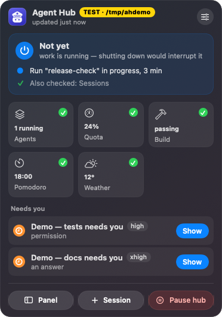
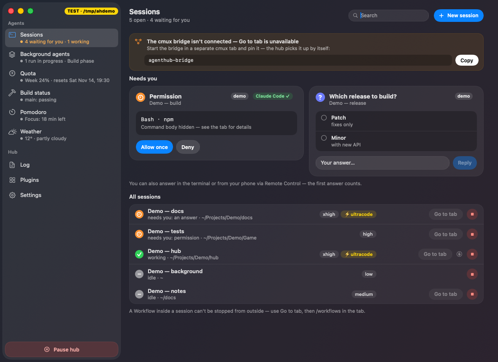

# Agent Hub

A macOS menu bar app that shows the status of every AI agent on your Mac — Claude Code sessions, background
workflow runs, your Claude subscription quota and anything a plugin reports — calls you when you are needed, and gives
you one place to act: answer a session, interrupt or stop it, launch a new one.

The core is a portable Node daemon with SwiftBar-style plugins; the shell is a SwiftUI app in the macOS 26 style, built
without Xcode.





*Screenshots from a test hub with demo data: synthetic sessions and answer cards, a synthetic workflow run and quota
read by the built-in `agents` and `quota` plugins, and three throwaway local plugins written for the screenshots
(Build, Pomodoro, Weather — they are not part of the repository; the built-in plugins are in [`plugins/`](plugins)).*

## Features

- **Daemon `agenthubd`** — listens only on a Unix socket with mode 0600 and never opens TCP for its API. Every client is
  classified by its process and code signature (`app` / `hook` / `bridge` / `cli`). Live updates over SSE, action
  confirmations decided by the core, a metadata-only journal, and a hub pause that stops every action at once. Services:
  push notifications, answers to sessions (hook), actions and the cmux bridge, the plugin manager, secrets from the
  Keychain, the Claude quota, OAuth connections, hub auto-update.
- **Built-in plugins** that ship with the app: Claude Code sessions (`claude-sessions`), background workflow runs
  (`agents`), the subscription quota (`quota`) and a token spend journal with its API list price equivalent
  (`spend`).
- **Plugins** — official ones from a signed registry, community ones, and your own from a local folder. A plugin's tier
  (`builtin | official | own | community | local`) comes from where it was installed, the signed registry index and
  your consent, never from the plugin's own metadata. Plugins can declare their own actions, notification rules,
  icons and connections; the hub builds the UI from those declarations and knows no plugin by name.
- **The app** `AgentHub.app`:
  - popover: plugin tiles, "Waiting for you", a "Can I shut down" verdict, Panel / Session / Pause hub;
  - panel: sessions with "go to tab / interrupt / stop", answer cards for permission requests and questions
    (allow once / deny, options, multi-select, "Other"), a session launch form, the plugin manager with a
    permissions window, the journal, settings;
  - native notifications: a click opens the plugin's link or its page, and a plugin may put up to two of its buttons
    on the banner; confirmations with text written by the core;
  - English and Russian (System / English / Русский).
- **cmux bridge** (`bridge/`), **hook** (`hook/agenthub-hook`) and a **Claude Code plugin** (`claude-plugin/`) to
  answer sessions from the hub.

## Requirements

- macOS 26 or later
- Command Line Tools for Xcode (git, swift, clang, macOS SDK 26)
- Node.js 22 or later (with headers — a regular Homebrew or nodejs.org install)

## Install

### Homebrew

```sh
brew install KenseiTheOne/tap/agent-hub
agenthub setup
```

`brew install` puts the release source tree (into `$(brew --prefix)/opt/agent-hub/libexec`) and the `agenthub` command in
place; Homebrew installs Node.js itself. `agenthub setup`, run in your own Terminal, finishes the install with the same
builder that installs updates: it checks the Command Line Tools (swift, clang, macOS 26 SDK — `xcode-select --install`),
builds the app from the Homebrew tree (2–5 min), pins the build, copies the built-in plugins, adds the launchd job and
starts the hub. It asks for confirmation ("y"); `agenthub setup --plan` only shows the plan.

A Homebrew-installed hub does not look at git tags — new versions come from Homebrew:

```sh
brew upgrade agent-hub        # then press "Update" in the Agent Hub menu
```

After the upgrade the hub notices the new version within a few minutes (or on "Check now" in Settings → Hub updates)
and offers "Update": it builds the version next to the running one, test-runs it and rolls back by itself if it fails.
To uninstall — in this order, since Homebrew knows nothing about the hub's launchd job and data:

```sh
agenthub uninstall --apply    # --purge also removes settings, the journal and plugin data
brew uninstall agent-hub
```

Homebrew downloads the release tarball from GitHub; no credentials are needed. Details:
[`docs/hub-updates.md`](docs/hub-updates.md) §8b.

### From source

One command, in your own Terminal:

```sh
curl -fsSL https://raw.githubusercontent.com/KenseiTheOne/agent-hub/main/scripts/install.sh | bash
```

or, from a clone of this repository, `bash scripts/install.sh`.

`scripts/install.sh` is a self-contained file: you can copy it anywhere and run it from there, or rename it to
`Install Agent Hub.command` (`chmod +x`) and open it with a double click. The installer:

- checks macOS 26, the Command Line Tools (git, swift, clang, SDK 26) and node ≥ 22, and tells you what is missing and
  how to install it;
- fetches the `main` branch from origin with git (the repository is public, no credentials needed; the hub has no tokens
  of its own); by default `https://github.com/KenseiTheOne/agent-hub.git`, `--origin <url|path>` — another address or a
  local clone (`--origin ~/path/to/agent-hub` — no network needed);
- installs the latest `vX.Y.Z` release on `main` (no tags — `main` itself, version "X.Y.Z (build from a commit)") into
  `~/Library/Application Support/AgentHub/Versions/<version>` with the same builder that installs updates: a 2–5 min
  build, pinning the build, a copy of the built-in plugins, a launchd job and launch — the icon appears in the menu bar;
- moves a hub that runs from a working folder into a standalone installation, keeping settings, the journal, plugins
  and their data;
- is safe to re-run: the same version — check and repair without rebuilding; another version — a refusal with a hint
  to update with the "Update" button;
- does not install the Claude Code hook (it never touches `~/.claude`) — it prints the command to connect it.

After that, new versions arrive by tags: "Update" in the hub menu ([`docs/hub-updates.md`](docs/hub-updates.md)). To see
the plan without changing anything — `bash install.sh --plan`. To uninstall — `bash install.sh --uninstall` (settings,
the journal and plugin data stay; `--purge` removes them too). Confirmation is typing "y"; without a terminal the
installer refuses.

### Answering sessions from the hub

To get Claude Code permission requests and questions as cards in the hub, connect the Claude Code plugin
(`claude-plugin/`) — see [`claude-plugin/README.md`](claude-plugin/README.md) and [`docs/hook.md`](docs/hook.md). To
switch to session tabs and launch sessions in cmux, start the bridge — [`bridge/README.md`](bridge/README.md).

## Own plugins

A plugin that does not belong in the public catalog (a private tool) lives in that tool's repository —
`agenthub/<id>/` in the same format as a registry plugin (a main file with metadata, README, `test/`, `fixtures/`) — and
is installed from that folder:

```sh
node "$HOME/Library/Application Support/AgentHub/Versions/current/src/daemon/bin/agenthub" plugins install --from ~/path/to/my-tool
```

or with "Add from folder…" in the plugin manager. The command does not install — it files a request: you confirm the
installation in the pinned app ("Plugins" → "Waiting for confirmation" → "Review and install"; the consent window shows
the folder, version, content fingerprint and permissions); without a pinned app it refuses with an explanation. The
folder check is the same as in registry CI; only you should be able to write to the folder. The hub runs its own copy
and watches the folder: an edit without new permissions is installed automatically (and journaled), new permissions
show "Update available" and a consent window, and if the folder disappears the last copy keeps running with a warning.
Such a plugin's tier is "own": trusted like an official plugin (actions, its own notifications, the hub quota), labeled
"own · <path>" in the UI.

How to write a plugin — a quick start, metadata tags, output, actions, permissions, the environment, the hub API for
plugins and shipping — is in [`docs/writing-plugins.md`](docs/writing-plugins.md). The reference behind it: the plugin
contract in [`docs/extension-points.md`](docs/extension-points.md); registry, consent and own sources in
[`docs/plugins-registry.md`](docs/plugins-registry.md).

## Documentation

| Document | What |
|---|---|
| [`docs/writing-plugins.md`](docs/writing-plugins.md) | a guide for plugin authors: from a first plugin to publishing |
| [`docs/extension-points.md`](docs/extension-points.md) | the plugin contract and daemon extension points (primitives, routes, services) |
| [`docs/api.md`](docs/api.md) | the daemon HTTP API on the Unix socket |
| [`docs/plugins-registry.md`](docs/plugins-registry.md) | the plugin registry, manager, tiers and own sources |
| [`docs/hook.md`](docs/hook.md) | answering Claude Code sessions: hook, cards, `session.respond` |
| [`docs/hub-updates.md`](docs/hub-updates.md) | hub auto-update, the installer and the release procedure |
| [`daemon/lib/push/README.md`](daemon/lib/push/README.md) | push notifications (macOS banners, plus webhook/ntfy and service channels): rules, kinds, quiet hours, the morning digest |
| [`app/README.md`](app/README.md) | the SwiftUI shell: features, building without Xcode, diagnostic flags |
| [`bridge/README.md`](bridge/README.md) | the cmux bridge and action primitives |
| [`docs/windows.md`](docs/windows.md) | Windows groundwork |
| [`CHANGELOG.md`](CHANGELOG.md) | history of changes |

## Project layout

| Directory | What |
|---|---|
| `daemon/` | the `agenthubd` daemon and the `agenthub` CLI (Node ESM, no dependencies) |
| `daemon/lib/primitives/`, `routes/`, `services/`, `terminals/` | extension points (auto-loaded); on one Mac the same modules can live in `<state dir>/Extensions/`, loaded after a human approves each file — [`docs/extension-points.md`](docs/extension-points.md) |
| `daemon/lib/push/`, `hook/`, `registry/` | push ([`push/README.md`](daemon/lib/push/README.md)), answer cards, minisign / tar / permissions linter shared with the registry |
| `daemon/native/peercred/` | an N-API addon: pid, path and ancestors of the socket peer |
| `plugins/` | built-in plugins (claude-sessions, agents, quota, spend): `<id>/<id>.<interval>.mjs`, README, fixtures |
| `app/` | the SwiftUI shell (SwiftPM, macOS 26) — [`app/README.md`](app/README.md) |
| `bridge/` | the cmux bridge — [`bridge/README.md`](bridge/README.md) |
| `hook/` | `agenthub-hook` — [`docs/hook.md`](docs/hook.md) |
| `claude-plugin/` | the Claude Code plugin `agent-hub` (installed by the user) |
| `launchd/` | `com.kensei.agenthub.plist` — generated locally by `agenthub install` / `agenthub setup`, not tracked in git |
| `docs/` | documentation (table above) |
| `scripts/` | `install.sh` (installer), `build-native.sh`, `bundle.sh`, `build-release.sh`, `app-test.sh`, `make-signing-cert.sh`, `set-version.sh` |

## Building and testing

```sh
./scripts/build-native.sh                                   # peercred addon: clang from the CLT, node headers, no node-gyp
cd daemon && env -u NODE_OPTIONS node --test 'test/*.test.mjs'   # daemon, plugins, bridge, hook, push, registry
scripts/app-test.sh                                         # AgentHubKit tests (Swift Testing)
scripts/bundle.sh                                           # release + AgentHub.app, ad hoc, not pinned
scripts/bundle.sh --home <dir>                              # and pin it in a test state directory
```

Clear `NODE_OPTIONS` if your terminal sets a preload (cmux does, and it crashes child node processes). The tests build
the addon themselves if it is missing; they run in temporary directories, install nothing and do not use the network.
The built app is `app/build/AgentHub.app`. Building without Xcode is described in [`app/README.md`](app/README.md).

## Running against a test directory

```sh
H=$(mktemp -d /tmp/ah-XXXX)
printf '{"services":{"push":{"enabled":false}}}\n' > $H/config.json      # no osascript banners while testing
AGENTHUB_HOME=$H env -u NODE_OPTIONS node daemon/bin/agenthubd &
AGENTHUB_HOME=$H env -u NODE_OPTIONS node daemon/bin/agenthub status
curl --unix-socket $H/hub.sock http://hub/state
app/build/AgentHub.app/Contents/MacOS/AgentHub --home $H --open-panel   # the shell against this daemon
kill %1
```

Without `AGENTHUB_HOME` the daemon works in `~/Library/Application Support/AgentHub/`. In test mode the keychain is not
read. Shell flags for checks (`--panel-section`, `--show-popover`, `--demo-cards`, `--probe-peer`,
…) are described in [`app/README.md`](app/README.md).

## Manual installation from a working folder (developers)

```sh
scripts/bundle.sh                                           # ad hoc, not pinned; --home <dir> — pin in a test directory
node daemon/bin/agenthub install                            # plan only; generates launchd/com.kensei.agenthub.plist (not tracked)
node daemon/bin/agenthub install --apply                    # LaunchAgent
node daemon/bin/agenthub pin-app <AgentHub.app> [--dry-run] # pin a build by hand
node daemon/bin/agenthub hub migrate [--apply]              # move the hub from the working folder into Versions (like the installer)
node daemon/bin/agenthub install --registry-pubkey <file.pub> --registry-url <url> --apply --no-launchd   # registry
node daemon/bin/agenthub uninstall [--apply] [--purge]      # remove: daemon, app, launchd, versions
```

Without `--apply` nothing changes. Without a signature requirement the `app` class is unreachable: confirmations,
answers, stops and launches are impossible, and that is by design.

The daemon and the app live together: if the app is dead but the daemon is alive, the daemon brings the app back; when
you quit the app, the daemon exits too. Quitting the app stops the daemon (`POST /shutdown`, exit code 0 — the
LaunchAgent with `KeepAlive = {SuccessfulExit: false}` does not restart it; a daemon crash is restarted by launchd as
before). If the app crashes, the daemon relaunches it from the pinned build's path (at most 3 times in 10 min, then a
notification "Agent Hub keeps crashing — restarts stopped"). If the app starts without a daemon, it brings it up itself
(`launchctl kickstart`). Details: [`docs/api.md`](docs/api.md) (`POST /shutdown`, "App supervision"),
[`app/README.md`](app/README.md).

Only one pinned build is in force: after the next `bundle.sh` the previous copy gets 403. The daemon picks up every
change of `requirements.app` without a restart, writes it to the journal (`app-requirement-changed`), sends the
notification "Agent Hub re-pinned" and shows a panel note "The app was rebuilt and pinned · <time> · from a Claude Code
session" with "That was me" and "Journal" buttons. If you did not pin it, that is a reason to investigate. This is not
protection against an agent running as the same user: such an agent can rewrite both `config.json` and the daemon
itself. An optional certificate mode suits those who do not want to re-pin after every build:
`scripts/make-signing-cert.sh`, `agenthub install --app-cert-sha1 <SHA1> --apply --no-launchd`, then
`scripts/bundle.sh --cert`.

## CLI

`agenthub status [--json]`, `agenthub logs [-n N] [-f] [--json]`, `agenthub refresh <plugin>`,
`agenthub pause` (hub pause: answers to sessions, launches, stops and plugin actions are off; lift it with "Resume" in
the app or by deleting the file `<AGENTHUB_HOME>/ESTOP`; old name — `agenthub estop on`),
`agenthub lang` (the hub language: setting and effective value; change it only from the app),
`agenthub pin-app <AgentHub.app>`, `agenthub install …`, `agenthub uninstall [--purge]`,
`agenthub plugins install|remove <id>`, `agenthub plugins install --from <folder>` (a request for an own plugin — a
human installs it in the app), `agenthub hub [status|install|migrate|rollback]`.
The CLI speaks the hub language (English unless the hub language — the setting in the app, or the macOS language for
"System" — is Russian); `--json` output, error codes and paths are the same in both languages.
The CLI is not put on `PATH`: the full path is `<repository>/daemon/bin/agenthub`, and after the installer
`~/Library/Application Support/AgentHub/Versions/current/src/daemon/bin/agenthub` (the plugin manager in the app shows
the registry connect command with that path).

## License

[MIT](LICENSE)
