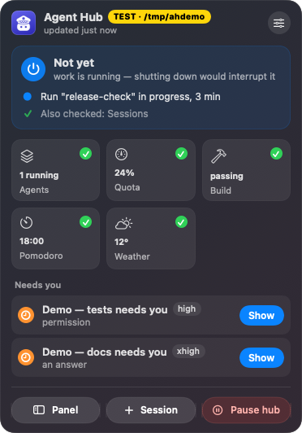
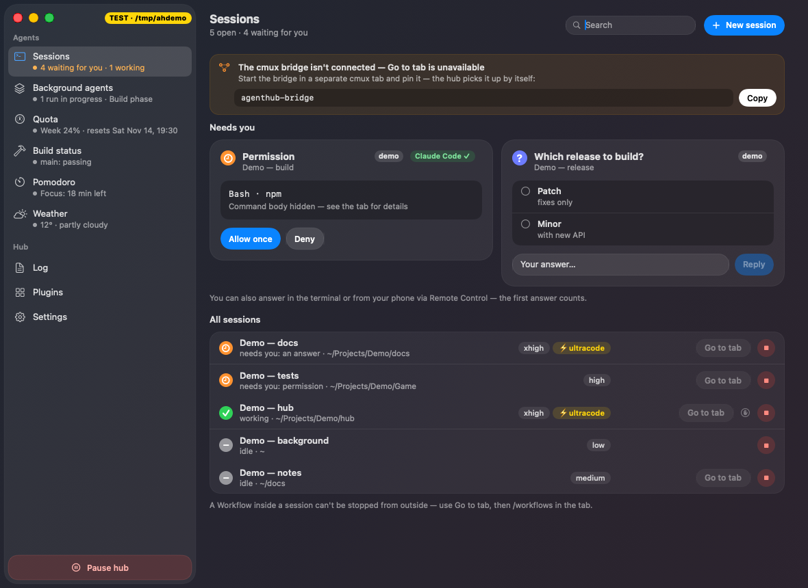
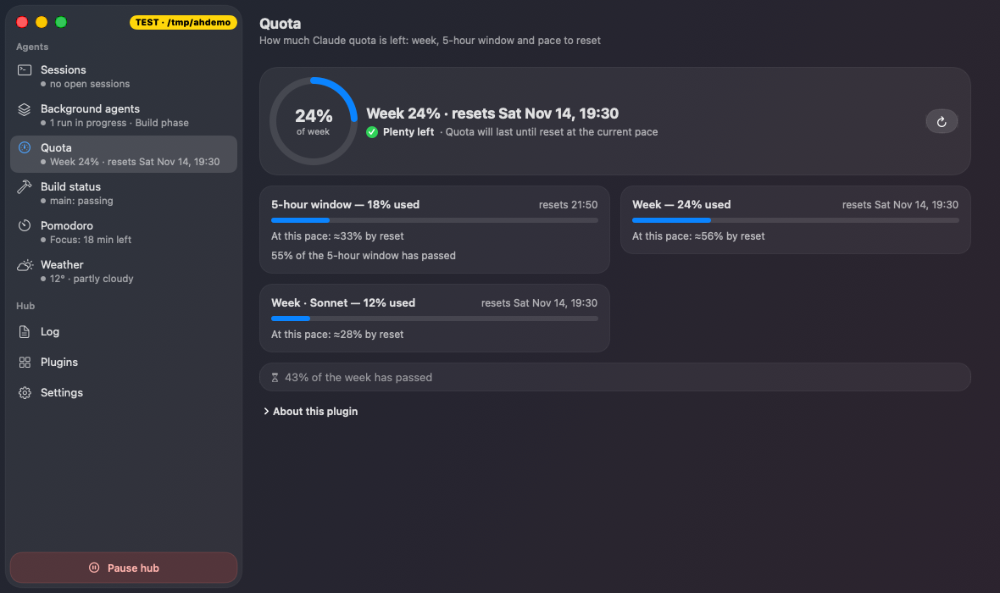
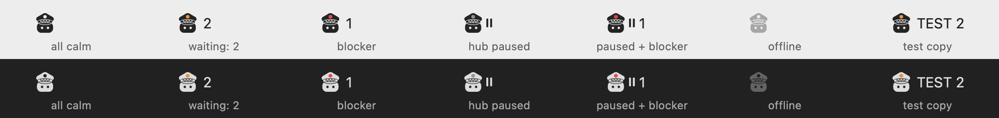

# AgentHub.app — the shell (stage 3)

A menu bar icon, a popover and a panel on top of the `agenthubd` daemon. A SwiftPM package, macOS 26+ (Tahoe glass,
following the approved prototype), without Xcode (Swift 6.4 from the Command Line Tools). It talks to the daemon over
HTTP/1.1 on the Unix socket `hub.sock` via AsyncHTTPClient (`http+unix://`; `URLSession` cannot do Unix sockets). The
protocol is described in [`docs/api.md`](../docs/api.md).







## What is there

| Part | Where | What it does |
|---|---|---|
| Icon | `StatusStyle.swift` (`StatusImages`, `MenuBarArt`), `MenuContent.swift` (`MenuBarLabel`, `StatusItemTip`), `AgentHubKit/Presentation.swift` (`MenuBarLook`) | A cop bot in a peaked cap from `app/Resources/MenuBar` (in the bundle — `Contents/Resources`). All calm — a template image (macOS tints it), the cap emblem is a cut-out; someone is waiting — the emblem is orange with the number of waiting items as text next to it; blocker (block/error) — the emblem is red; hub paused — the emblem is grey (red if there is a blocker) with a "‖" sign to the right of the bot; no connection — the bot is fainter than "quiet" (0.3) with a "?" sign on the right (review 2026-11-07: faintness alone barely differed from "quiet", and "no connection" means "I know nothing", not "OK to shut down"). By the "can I shut down" verdict (`/state.idle`, 2026-11-07): work in progress — the emblem is blue; quiet — the whole bot is dimmed (0.5), the emblem is a cut-out; quiet, but the computer will be needed later (a plugin's needsOn) — dimmed with an indigo emblem. Priority: block > waiting (orange + number) > work > quiet with needsOn > quiet; no verdict (an older daemon, "checking" for the first seconds after the daemon starts) — as before. "Waiting" (orange emblem and number) covers only sessions waiting for an answer and question cards (PermissionRequest, answers); a plugin's `status=wait` does not tint the icon (decision 2026-11-07: a runner plugin in its "doing nothing" mode reported a constant `status=wait`, and the icon was orange although the card said "OK to shut down") — it is visible in the popover (tile, "Waiting for you") and the sidebar (orange dot), while the icon follows the "can I shut down" verdict. In colored states the bot is drawn with the menu bar's `labelColor` — the same tone as the template and the number. The icon is never clipped by a badge. A test copy shows the text «ТЕСТ» (and the number) next to it. The tooltip is the state (when paused — the blocker too) and «ТЕСТ · <directory>» for a test copy.  |
| Popover | `MenuContent.swift` (`PopoverView`), `IdleCardView.swift` (`IdleVerdictCard`), `AgentHubKit/Presentation.swift` (`IdleCard`) | `MenuBarExtra` with the `.window` style: above the tiles, the "Can I shut down" card (mockup F, 2026-11-07): "OK to shut down" (green) / "OK, but <plugin> needs the Mac at 04:30" (orange) / "Not yet" (blue — only because of work in progress), a subtitle, obstacles one per line (● work, ! needs the Mac, ? the hub does not know — the sessions plugin did not answer, a participant failed; a line leads to its panel section, the tooltip names the source plugin; third-party plugins' phrases carry their name), then a grey ○ summary "2 sessions are waiting for an answer: … — you can answer after turning the Mac back on" (2026-11-09: sessions waiting for an answer do not change the verdict — they do nothing by themselves; the line's tooltip says exactly what will happen: sleep does not affect them, after shutdown use `claude --resume`, the question window will not come back by itself and the asked step is not done; waiting sessions only — "OK to shut down · no work in sight — waiting sessions can wait", and the tooltip adds that background agents and session commands stop on shutdown and do not resume by themselves; a waiting session with visible work — a subagent card, `waitingFor` "worker request", `busy` with a card — is an obstacle ● "1 session is working and waiting for an answer on a step: …" and "Not yet"; an older daemon that said "not yet" because of waiting sessions alone is recomputed when parsing — `IdleVerdict.init(from:)`), everything fine — one grey line "Also checked: …" (at most 4 names, long ones truncated, then "and N more"); "OK, but …" from needsOn only for built-in and official plugins; with a "?" line — "OK, but not everything is known"; collapsed — at most 4 obstacle lines, one per plugin, and "N more", which expands in place on click; an expanded list longer than the screen scrolls inside the card; plugin tiles (icon, status glyph, a short value; click to expand), "Waiting for you" — cards, waiting sessions (with an effort capsule if it fits) and blockers with an action in the line; below them, as a separate block titled "Updates", the hub and plugin update lines (without a title they read like "Waiting for you" items); Panel / Session / Pause hub capsules; ⌘P, ⌘R, ⌘,, ⇧⌘E, ⌘Q. Any action that opens a window (Panel, Session, "Show"/"Go to", Plugins, Journal, Settings, a plugin page) first closes the popover (`PanelRouter.closePopover`: a click on its own icon button — the same path a human takes, so the next click on the icon opens it again; `orderOut`/`close` on the window broke SwiftUI state). Without the cmux bridge a waiting session gets "Show" (the panel shows how to start the bridge) |
| Icon menu | `StatusItemMenu.swift` | right click or ⌃-click on the icon: "Panel", "Pause hub" / "Resume" (the same action as the button; what to do is decided when the menu opens, so a pause change while the menu is open does not flip the click; "Resume" is disabled for an unpinned build), "Quit Agent Hub" (also stops the daemon — `POST /shutdown`, see "Daemon and app lifecycle"). MenuBarExtra knows nothing about right clicks — a local `NSEvent` monitor swallows the click on its own NSStatusItem button (the popover does not open; an open one closes) and shows `NSMenu.popUp` under the button; left clicks work as before |
| Panel sidebar | `PanelView.swift` (`Sidebar`, `PanelMetrics`), `AgentHubKit/Presentation.swift` (`SidebarStatus`) | width 280 (the window is at least 960). An item is an icon and a 13 pt name; on the right only a number in a blue capsule (plugin updates on "Plugins"), no word pills. The second line, 11.5 pt, is a severity dot (grey — calm, orange — waiting/attention, red — block/failure) and the status in words on one line, truncated with an ellipsis: for a plugin — the header title (as shown large on its page) without the leading plugin name ("Runner won't start: …" → "won't start: …"); a header equal to the name, or none — the status label; failure — "Plugin failed: timeout", as on the page (the header from the last good frame only in the tooltip). "Sessions" shows "2 waiting for an answer · 5 working": waiting means sessions (waiting in the list and with an answer card, by `sessionId`), not cards; from the `claude-sessions` plugin — "1 broke off" (orange), its reason "no sessions visible" (orange), "The sessions plugin did not answer" (red); nobody waiting or working — "3 idle", no sessions — "no open sessions". "Plugins" shows "2 updates" (orange if a new version asks for more permissions). No connection to the daemon — the lines of the last snapshot in grey, tooltip "no connection to the hub, data as of the disconnect"; "Sessions" without sessions — "no connection to the hub". Journal and Settings — one line each. The full status is in the hover tooltip (`.help`) and the accessibility label (name, status). Sections and items scroll (`ScrollView`, indicator hidden): the traffic light row at the top and "Pause hub" at the bottom stay in place, two-line items are not squeezed; the icon sits in a 20×16 frame aligned to the top, so the item height does not depend on the symbol. The «ТЕСТ» label takes all the space to the right of the traffic lights |
| Panel | `PanelView.swift` | sidebar: "Agents" — "Sessions" and plugin pages, "Hub" — "Journal", "Plugins", "Settings"; on the right — the section (for a plugin — blocks, the body is split by `---`). There is no separate overview: session answers are built into "Sessions", launching is a modal window on top of them. Hub pause, connection, an unbuilt build and the re-pin note are banners above the section (`PanelBanners`), "Pause hub" is at the bottom of the sidebar; a banner if the daemon does not see the app as `app` |
| Panel window | `MenuContent.swift` (`PanelChrome`), `PanelView.swift` (`PanelMetrics`, `SidebarCard`) | a transparent window without a title, with an empty unified toolbar: the system corner radius of 26 pt (as in the prototype) and the traffic lights at (19, 19). The backing (`GlassBackground` without a radius) covers the whole window with no frame of its own: the system rounds the corners, one radius. The sidebar card is inset by 6 pt and shaped as a `ConcentricRectangle` (26 − 6 = 20 pt); menu items and "Pause hub" are concentric with the card; the traffic lights sit inside the card with a 13 pt margin — the same as the menu item icons (6 + 7). `--open-panel` prints the button frames (`panel-button-close=x:19 y:19 …`) and `panel-corner-radius=26.0` |
| Session effort | `PanelView.swift` (`EffortBadge`), `AgentHubKit/Models.swift` (`SessionInfo.effort`, `ultracode`) | a `low/medium/high/xhigh/max` level capsule and "⚡ultracode" in the session line and in "Waiting for you"; tooltip "from the last turn — may be stale for an idle session". The source is `/state.sessions[].effort` (the claude-sessions plugin) |
| cmux bridge | `PanelView.swift` (`BridgeNotice`, `BridgeText`, `BridgeSettings`), `AgentHubKit/HubStore.swift` (`bridgeOnline`, `canFocusTabs`) | from `/state.bridge` and the `bridge.connected`/`bridge.disconnected` events: without the bridge, "Go to tab" (sessions, "Waiting for you", answer cards, plugin `session.focus`/`cmux.focus` offers) is disabled with a tooltip; "Sessions" and the launch form show a banner with the bridge start command (`AGENTHUB_HOME=… <repo>/bridge/agenthub-bridge` if the hub directory is not the default) and "Copy" instead of an NSAlert after a click; "Settings" shows "cmux bridge: connected · since … · vN" or "not connected" with the same command |
| Confirmation | `AlertPresenter.swift` | `NSAlert` with text and price **from the core** (a 428 response); the shell only passes consent back as a token |
| Live stream | `AgentHubKit/HubStore.swift` | SSE `GET /events`, reconnecting from 0.5 to 30 s, `Last-Event-ID` (reset — and the daemon sends a snapshot — if the daemon pid changed, the peer class from `GET /peer` changed, or `app-pin.changed` arrived: replay does not carry `peer`, and after a re-pin this copy's class may have changed); on `app-pin.changed` the class is re-read right away. `: ping` (every 15 s) refreshes "updated …" in the popover header; no polling |
| Models and client | `AgentHubKit/` | parsing of `/state` and events is lenient: extra fields and unknown statuses do not crash the shell |
| Session answers | `ResponsesView.swift` | `GET /hook/cards` cards via SSE `hook.card*`: permission — the tool and a summary without the body, "Allow once" / "Deny"; question — options, multiSelect, "Other"; the answer goes through `session.respond` |
| Session launch | `LaunchSessionView.swift` | folder (NSOpenPanel), name, prompt → `session.launch` (428 → NSAlert with the price). The form closes after launch; the outcome from `bridge.launch.*` ("tab opened, waiting for the session" → "appeared" / "did not appear within a minute") is a banner in "Sessions" with "Hide"; reopening the form resets the previous outcome |
| Plugin manager | `PluginManagerView.swift` | installed (built-in / official / community / "unverified"), the registry catalog, a permissions window with a "why" and a "new" badge (`AlertPresenter.consent`), update, removal (with data — by a checkbox). An installed plugin's "Permissions" has a subtitle by tier (built-in / local / "requested no permissions"); the removal and permission windows close with Esc. Versions are compared by semver (`PluginVersion`: `1.3.0-beta.1` < `1.3.0`). A catalog card of an installed plugin shows "Installed" and "Remove"; with a newer version — "Update to X" (with more permissions — the line "asks for more permissions" and the permissions window); with an older one — "Roll back to X" with a confirmation; blocked by the registry — the reason and "Remove". Below ~1110 pt of window width the catalog uses one column; the author is shown as a name and an @login linking to GitHub |
| Own plugins (2026-11-09) | `PluginManagerView.swift` ("Add from folder…", `ownRequestsList`, `ownUpdateButton`, `TierBadge` "own · <path>", `RequirementLine`), `AlertPresenter.swift` (`ConsentSheet`: folder, fingerprint, migration `OwnNoticeBox`), `MenuContent.swift` (`ownRequestLine`), `AgentHubKit/Features.swift` (`OwnRequest`, `OwnSourceInfo`, `ConsentSource`, `PluginMigration`, `PluginRequirement`), `L10n.swift`, `HubStore` (`addFromFolder`, `approveOwn`, `declineOwn`, `ownRequests`) | "Add from folder…" (NSOpenPanel) → request `POST /registry/own/request` → consent window from the daemon (428) → installation with a token. Requests from the terminal (`agenthub plugins install --from`) appear as a "Waiting for confirmation" block in the manager ("Review and install", "Decline") and as a line in the popover with "Open". An own plugin in the list has the label "own · <path>" (the tooltip shows the full path), an orange line if the folder is missing or fails the check (the last copy keeps running), "Update · new permissions" if the new content asks for more permissions. The consent window for an own source shows "own folder · <path> · fingerprint …" instead of a registry signature, the full path, who can change the folder, a "content changed after the request" mark and a migration banner ("Will replace the official … with your own", a "Replace" button). Catalog: "Requires <program>" as a link from the plugin's `<agenthub.requires>` (the shell knows nothing about programs); if it is missing, "Install" is dimmed with a tooltip; if an own plugin with the same id is installed — "Own installed · <path>". A snapshot of the consent window: `--snapshot-consent <png>` (the first request) or with `--consent-install <id>` |
| Plugin updates | `PanelView.swift` (`Sidebar`, `PluginUpdatesSettings`), `MenuContent.swift` (`PopoverView.updatesLine`), `AgentHubKit/Models.swift` (`PluginUpdates`), `Presentation.swift` (`PluginUpdateLine`, `PluginUpdatesStatus`, `SidebarStatus`, `NotifyTarget`) | from `/state.pluginUpdates` and the `plugins.updates` event (the daemon's background check every 6 h): a blue capsule with the number of updates on "Plugins" in the sidebar and "N updates" as the second line; in the popover — "Update available: Weather 1.1.0" (with more permissions — orange "The new version asks for more permissions") with "Update", which opens "Plugins" and starts the manager's usual update flow (the permissions window with the difference if permissions grow); several — "Plugin updates: N", one line per plugin (up to three, then "and K more"; the name is truncated from the end, the version is always visible, the orange "more permissions" only for the one that needs it) and an "Open" button to "Plugins", where each has its own "Update". Text wraps rather than shrinks. "Settings" has "Check for plugin updates" (`PUT /settings/plugin-updates`, pinned build only; turned off in `config.json` — the switch is disabled) and the line "Last check · next · updates available" (`PluginUpdatesStatus`: the first attempt failed — "Could not check: no connection to the catalog · retry: …", short and without advice about buttons; turned off — just "Off"). The "Update available" notification's "Open" leads to "Plugins". |
| Notifications | `PanelView.swift` (`NotificationsSettings`), `AgentHubKit/NotificationsText.swift`, `AgentHubKit/Models.swift` (`NotificationsInfo`), `HubClient`/`HubStore.setNotifications` | the "Notifications" card in "Settings" (2026-11-09), from `/state.notifications` and the `settings.changed {notifications}` event: the master switch and a "where" line (macOS banners; Telegram — whether it is on in config.json), the kinds with an explanation under each — "Sessions waiting for an answer", "Hub and plugin updates", "Plugin failures and warnings", "Other from plugins", plus a toggle per plugin that declares one (contract 2) (disabled while the master switch is off), the line "A turned-off kind does not arrive at all — no banner, no Telegram, no morning digest; the event is visible in the popover and the journal" and "Open journal"; "Quiet hours" — a switch and "from … to …" (a menu in 30 min steps; a non-standard current time is kept), an explanation of the route and "Currently from config.json…" while the time is not set here, and the quiet hours time zone if it differs from the Mac's (`quiet.timezone`); the "away for more than N min" threshold comes from the daemon's `awayAfterMs`; a padlock block "Cannot be turned off" — the list of security exceptions from the daemon (pin and build path changes, "Agent Hub keeps crashing — restarts stopped", a moved release tag, an update stopped for signs of tampering, tampering markers declared by official plugins) and why they have no switch. Edits go through `PUT /settings/notifications` (pinned build only; without it or without a connection — disabled with a tooltip), input errors appear in a window with clear text. An older daemon — "unknown" and "update the hub". The daemon decides what to show — the shell does not filter banners. `--settings-focus notifications` opens right on the card (snapshots) |
| Connections | `ConnectionsView.swift` (`ConnectionsSettings`, `ConnectionCard`, `PluginConnectionBanner`), `AgentHubKit/Connections.swift` (`ConnectionInfo`, `ConnectionsText`, `HubClient.connect`, `HubStore.startConnect`/`connectionOp`) | "Settings → Connections" and a card above the page of the plugin the connection feeds, from `/state.connections` and the `connections.changed` event (2026-11-09): the state (connected · since … · read-only / waiting for confirmation in the browser / sign-in expired — connect again / not connected / unavailable without a keychain), the line "updated · next at … · requests today N of <budget>" — orange if less frequent because of the service's limit or the daily budget; "Connect <service name>" (`POST /connections/<service>/connect` → the browser opens the sign-in page; there is no confirmation window of our own — the confirmation is on the service's site), "Cancel" and "Open the sign-in page again" during sign-in, "Disconnect" with a confirmation (removes the sign-in from the hub keychain). Pinned build only; without it or without a connection — disabled with a tooltip. Sign-in errors (cancelled, 5 min expired, server not found, wrong iss, keychain) in clear text; `discovery` with a non-network reason (`errorReason`: a different issuer, no S256, …) — "<service name> changed its sign-in settings — update the hub" and the reason in small print. "Disconnect" failed — "Could not remove the sign-in from the keychain — press "Disconnect" again", the button stays; 403 — "<service name> does not give this sign-in access"; the keychain did not answer — "retry in a minute". The daily budget comes from the plugin's declaration (`dailyBudget`). Names, limits and texts come from the plugin's `<agenthub.connection>` declaration: the shell knows no service by name. The shell never sees tokens. `--settings-focus connections` opens right on the card (snapshots) |
| Sessions | `PanelView.swift` (`SessionRow`) | go to the tab (`session.focus` by the core's `focusable` flag; an older daemon — `cmux.focus`), interrupt the turn, stop — the core decides |
| Action availability | `AgentHubKit/Presentation.swift` (`ActionBlock`), `HubStore.gate`, `HubStore.canAct` | a button the core will certainly reject is disabled with a tooltip — the same checks in the same order as `POST /actions/:id`: no connection; an unpinned build (confirmed and app-only actions: "End", "Interrupt", "New session" and "Session", confirmed plugin offers and actions, actions of non-built-in plugins of any tier — `offer.appOnly`, for example a plugin's mode toggle without a window, "Resume" while paused, language, "Check for plugin updates"); hub pause (only `open.url`/`open.file` work, in the cell strip too); the cmux bridge ("Go to", "Interrupt turn", launching). The launch form opens without the bridge too — it shows a banner with the command |
| Notifications | `Notifier.swift` | `push.notify` → `UNUserNotificationCenter` with an "Open" button → `POST /push/ack`. Only a pinned build shows its own banner (the daemon rejects an unpinned build's ack, and the banner would also be shown via osascript). Permission is requested at the first notification; that one comes from the daemon (osascript), later ones from the shell. "Open" leads to the plugin page; for hub events (`@hub`, a source with "@") — "Plugins" for `@hub:plugin-update:*`, otherwise "Sessions"; for the sessions plugin (`claude-sessions`) — "Sessions", where the answer cards are (`NotifyTarget`; the `claude-sessions` page from the popover leads there too — `PanelSection.resolved`) |
| Models | `AgentHubKit/Features.swift` | cards, answers, the launch draft, the catalog, the permissions window, notifications |
| Daemon lifecycle | `AgentHubKit/DaemonLifecycle.swift` (`DaemonStarter`, `QuitPolicy`, `DaemonLaunchState`, `LegacyLoginItem`, `PinPathHint`), `HubStore.shutdownDaemonOnQuit`/`startDaemonIfNeeded`/`setLaunchAtLogin`, `AgentHubApp.swift` (`AppDelegate.applicationShouldTerminate`, `LegacyLoginItemCleanup`), `PanelView.swift` (`LaunchAtLoginSettings`, the path banner in `PanelBanners`) | quitting also stops the daemon, starting without a daemon brings it up, "Launch at login" covers the daemon + app pair (section below) |

Autostart is the "Launch at login" switch in "Settings" (decision 2026-11-07): a setting of **the daemon + app pair**,
stored in the daemon (`settings.json → launchAtLogin`, `PUT /settings/launch-at-login`, only the pinned build may change
it; `/state.launchAtLogin`, event `settings.changed`). On — at login launchd brings up the daemon (RunAtLoad), which
launches the app after 2 s; off — neither starts at login (a daemon started by launchd waits 30 s for the app and exits
normally). An app opened by hand brings up the daemon itself (kickstart) regardless of the setting, and the daemon
restarts a crashed app regardless of it too. The app's own registration in "Login Items" (`SMAppService.mainApp`, the
former switch) is no longer needed: it would launch the app even with the setting off — the shell removes it
(`LegacyLoginItemCleanup`; only for the live hub and not in a diagnostic run), but only based on a state snapshot showing
that the daemon will launch the app at login (`LegacyLoginItem.daemonLaunchesApp`: the daemon knows the setting, the
pin has a build path, the LaunchAgent is installed). Otherwise the registration stays, and the "run agenthub pin-app"
banner says what is missing. An old LaunchAgent (`/state.launchAtLogin.launchAgent = "outdated"`, KeepAlive true — a
plist from before 2026-11-06): the switch is locked with the hint "reinstall: agenthub install --apply"
(`LaunchAgentHint`) — with such a plist the off setting does not work.

## Daemon and app lifecycle (2026-11-06)

"The hub is dead but the daemon is alive — the daemon brings the hub back. We close the hub — we close the daemon too."

- **Quitting.** Any quit — "Quit Agent Hub" in the icon menu and the popover, ⌘Q, logging out — goes through
  `AppDelegate.applicationShouldTerminate`: the shell stops its stream and sends `POST /shutdown` (waits for the answer
  for at most 2 s, `.terminateLater`). The daemon answers 202 and exits with code 0 — the LaunchAgent
  (`KeepAlive = {SuccessfulExit: false}`) does not restart it. An unpinned copy (class other than `app`) does not stop
  the daemon and does not send `/shutdown`; neither do diagnostic runs (`--snapshot-panel`, `--quit-after-snapshot`,
  `--snapshot-menubar`, `--print-status-item`, `--show-popover`, self-tests — `QuitPolicy.diagnosticArguments`), and
  they do not bring the daemon up.
- **Starting without a daemon.** No socket or the connection is refused — the shell checks the job
  (`launchctl print gui/<uid>/com.kensei.agenthub`), runs `launchctl kickstart gui/<uid>/com.kensei.agenthub`
  (without `-k`: a running daemon is left alone) and waits up to 10 s for the socket; at most once every 30 s
  ("Retry" resets this), never while quitting. If the socket never appears (kickstart hit a process that was still
  stopping: code 0, but nothing started), the attempt does not count towards the pause. Meanwhile the connection banner
  says "Starting the hub service…"; no job — "The hub service is not installed — run agenthub install" with the command
  `env -u NODE_OPTIONS node daemon/bin/agenthub install --apply`. Only for the default directory: a test copy
  (`--home`, `AGENTHUB_HOME`) does not touch launchd.
- **An app crash** is noticed by the daemon itself (the `app` connection dropped, no process) and it restarts the app
  from the pinned build's path — [`docs/api.md`](../docs/api.md), "App supervision". The path is written by
  `agenthub pin-app` (called by `bundle.sh --home/--pin-live`, and for a standalone installation by the hub update:
  `Versions/<version>/AgentHub.app`). The path is visible in "Settings" under the fingerprint ("The hub launches: …");
  a change is a journal note and a push. **No path** (a pin from before 2026-11-06, `--cert` mode) — the daemon does not
  launch the app, neither at login nor after a crash (there is no longer a fallback "bundle of the last connection",
  decision 2026-11-07): the panel shows an orange banner "The hub does not know where to launch the app from… Run
  agenthub pin-app" with a ready command (the full path to the daemon CLI from `/state.hub.cli`, `AGENTHUB_HOME` for a
  test directory, the path of this bundle if this copy is the pinned one) and "Copy"; "Settings" shows the same as a line
  under the fingerprint; the journal says "App not launched: the build path is not recorded — run agenthub pin-app".
- Tests: `Tests/AgentHubKitTests/LifecycleTests.swift` — quitting sends `/shutdown` (daemon double), an unpinned copy
  does not, starting without a daemon calls `print` and `kickstart` through a replaceable runner (`CommandRunner`), no
  job — a banner without `kickstart`, a test copy and quitting do not touch launchd (also after `reconnect()`); the 30 s
  pause — on a daemon double that comes up on kickstart and goes away; kickstart without a socket does not count towards
  the pause; diagnostic flags do not bring the daemon up; the `app-pin.path-changed` event updates the path in the
  snapshot. `LaunchAtLoginTests` — "Launch at login" is written to the daemon (`PUT /settings/launch-at-login` to the
  double) and follows `settings.changed`, parsing of `/state.launchAtLogin` and `/state.hub.cli`, the old registration
  is removed only for the live hub and not in a diagnostic run, the path banner and its command.

## Hub updates (2026-11-06)

The live hub runs from a separate installation `~/Library/Application Support/AgentHub/Versions/<version>/` (the tag's
sources + the built app); the pointer is the `Versions/current` symlink. It is updated with a button, not by building
from the working folder. Design and release procedure — [`docs/hub-updates.md`](../docs/hub-updates.md).

- **Popover** — a line above the plugin updates (`HubUpdatePopoverLine`, `AgentHub/HubUpdateViews.swift`):
  "New hub version: 0.3.0" · the release description subject (the annotated tag message, up to two lines) · "Currently
  0.2.0" · "Update"; during installation — "Updating the hub to 0.3.0: downloading sources… / building… / verifying… /
  restarting…" (the builder step is `install.step`); built, but someone is waiting for an answer — "Hub 0.3.0 is built"
  · "Waiting for an answer: N — the restart will remove their cards" (sessions only — "Sessions waiting for an answer:
  N — better answer first") · a short "Restart"; failure (for a day, while there is nothing newer) — "Updating the hub
  to 0.3.0 failed" · "Details" (opens "Settings"); after an update — for a day or until "Got it" — "Hub updated to
  0.3.0" · description · "Was 0.2.0". Buttons size to their labels (`fixedSize`), text wraps rather than truncates.
- **"Settings" → "Hub updates"** (`HubUpdateSettings`): "Current version: 0.2.0" and the release description, "Check
  for hub updates", the check line, "What's new: …", the installation status ("Updating to 0.3.0: building…", "Built
  0.3.0 — waiting for restart…", "Could not update to 0.3.1: build error", "Log: <path>" and "Show log"; failure — by
  the popover rule), buttons: the main one ("Restart" in `ready`, otherwise "Update to …"/"… again"; absent during a
  build and in `ready` of the same version), "Check now", "Roll back to <previous>" (disabled in `ready`; if it does
  not fit in the row it goes on the next line, `ViewThatFits`); "Details" (expandable) — tag, commit, build time and
  fingerprint of the current, available and previous versions. The label after a migration without a tag is
  "0.1.0 (built from a commit)" (`HubUpdateText.displayLabel`). A hub that has not been migrated gets the hint "with the
  installer from the agent-hub repository folder — bash scripts/install.sh --origin ." and the full command with "Copy"
  (the installer, [`docs/hub-updates.md`](../docs/hub-updates.md) §8a; the update origin becomes this working folder,
  §7). If the tag of the available version moved — an orange line above the buttons, as in the popover; the outcome of
  the previous installation is not shown if the hub no longer runs from `Versions`. After a rollback, the version you
  left is not "new": the popover says "0.3.0 can be installed again" without a button, "Settings" — "Install 0.3.0
  again". A pin made by the installer is signed "by the hub installer" in the note. Buttons only for the pinned build,
  while connected and not while the hub is paused.
- "Update" and "Roll back" ask for confirmation first (`HubStore.installHubUpdate`/`rollbackHub` →
  `ConfirmPresenter.confirm`, texts — `HubUpdateText.installConfirm`/`rollbackConfirm`): the window title is the
  question itself ("Update the hub to 0.3.0?"), the text is the release description, the current version, a moved tag
  (both commits — then `acceptCommit`), a major version change; "Details: tag … · commit …" in small grey text under it
  (accessory view); the button is "Update"/"Roll back", not "Run" (`ConfirmRequest.title/button/details` exist only in
  the shell's own confirmations and are never read from a core response). Once per version the daemon sends the
  notification "A new Agent Hub version is built — waiting for restart" (a regular `push.notify`, "Open" as for hub
  events). The previous version button is "Roll back to X" or "Return to X" (X newer than the current one); it is absent
  when X is the available version.
- The note "The app was rebuilt and pinned" is not shown if the pin change was made by a confirmed hub update
  (`HubUpdateText.pinChangeIsOwnUpdate`: `by` from hub-update, fingerprint = the current version's build, installation
  `done`); otherwise the source is labeled "by a hub update" (`AppPinInfo.originText`).
- "Check for plugin updates" got a "Check now" button (`POST /registry/check-updates`).
- **Restarting into the new version**: the `hub-update.restarting` event → `HubStore.onHubRestart` (AppModel:
  `NSApp.terminate`), quitting **without** `POST /shutdown` (`hubRestarting`): the daemon restarts itself with code 75
  and launches the new app from `Versions/<new>/AgentHub.app`.
- Texts — `AgentHubKit/HubUpdatePresentation.swift` (`HubUpdateText`), model — `HubUpdateInfo` (`Models.swift`),
  tests — `Tests/AgentHubKitTests/HubUpdateTests.swift` (parsing state and events, popover and "Settings" lines,
  quitting on `hub-update.restarting` without `/shutdown`).

## Building

`scripts/bundle.sh` is a developer tool: **by default it does not touch the live installation** (since 2026-11-06).

```sh
scripts/bundle.sh                 # release + app/build/AgentHub.app, ad hoc, WITHOUT pinning (--no-pin is the same)
scripts/bundle.sh --home <dir>    # and pin this build in a test state directory (agenthub pin-app)
scripts/bundle.sh --pin-live      # pin in the LIVE hub (the default before 2026-11-06) — only deliberately
scripts/bundle.sh --cert          # optional: sign with the "AgentHub Local Signing" certificate
scripts/build-release.sh --out <dir>  # build a version for Versions/ (addon + bundle without pinning); called by the update builder
scripts/app-test.sh               # AgentHubKit tests (Swift Testing)
```

The app version (`CFBundleShortVersionString`) comes from the `VERSION` file at the repository root.

The built app is `app/build/AgentHub.app`. It is signed ad hoc; pinning (`--home`, `--pin-live`) records exactly this
build: `requirements.app = identifier "com.kensei.agenthub" and cdhash H"<cdhash>"` in the daemon's `config.json`.
The daemon picks this up without a restart, and the previous copy gets 403 `peer:app-signature` after the next build.
The pinned cdhash is the one the kernel (csops) reports for the running process: the build targets the native
architecture only. Every change goes into the daemon journal and arrives as a notification, and the top of the panel
shows a short note "The app was rebuilt and pinned · Nov 5, 11:57 · from a Claude Code session" (based on what
`agenthub pin-app` says: from a terminal or from under Claude Code) with the buttons "That was me" (hides the note for
this pin, remembered by the shell) and "Journal"; the fingerprint and the journal record key are under "Details". The
first pin (`appPin.old` = `none`) gets the note "The app was pinned". The push is called "Agent Hub re-pinned" (the
first one — "Agent Hub pinned", removal — "Agent Hub pin removed"); the shell does not suppress it — it is a separate
security channel.

The "AgentHub Local Signing" certificate is optional. It is for those who do not want to re-pin after every build:
`scripts/make-signing-cert.sh` (once, on the user's command, in a separate keychain `agenthub-signing.keychain-db` with
its own password), then `node daemon/bin/agenthub install --app-cert-sha1 <SHA1> --apply --no-launchd` and
`scripts/bundle.sh --cert`. Against an agent running as the same user it is no stronger than cdhash: the requirement
still lives in the daemon's `config.json`.

### Command Line Tools quirks

- In the macOS 27 SDK `@State` is a macro whose plugin (`SwiftUIMacros`) ships only with Xcode. So the code declares
  the `State` storage explicitly (`private let xStore = State(initialValue: …)` + a computed property) — the same
  property wrapper without the macro. `@Observable` works (the `ObservationMacros` plugin is in the CLT).
- `swift test` via swiftbuild sometimes does not pass the `TestingMacros` plugin to the compiler — `scripts/app-test.sh`
  sets the path explicitly.

## Running against a test daemon

```sh
H=$(mktemp -d /tmp/ah-XXXX)
AGENTHUB_HOME=$H env -u NODE_OPTIONS node daemon/bin/agenthubd &
app/build/AgentHub.app/Contents/MacOS/AgentHub --home $H --open-panel     # prints panel-window-id=<N>
screencapture -o -l <N> panel.png
```

Arguments (for manual checks):

| Argument | What |
|---|---|
| `--home <dir>` | daemon directory (otherwise `AGENTHUB_HOME`, otherwise `~/Library/Application Support/AgentHub`) |
| `--open-panel` | open the panel at launch, print `panel-window-id=<N>` |
| `--panel-section <section>` | `sessions`, `launch` (the form on top of "Sessions"), `manager` (or `plugins`), `journal`, `settings`, `plugin:<id>`; `overview` and `responses` are old aliases for "Sessions" |
| `--manager-tab catalog` | open the plugin manager straight on "Catalog" (screenshots) |
| `--settings-focus hub-update` | "Settings" straight on the "Hub updates" card — like "Details" for a failed update in the popover (snapshots) |
| `--settings-focus notifications` | "Settings" straight on the "Notifications" card (snapshots) |
| `--settings-focus connections` | "Settings" straight on the "Connections" card (snapshots) |
| `--show-popover` | show the popover content as a regular window, print `popover-window-id=<N>` (the menu bar popover cannot be opened programmatically without the Accessibility permission) |
| `--demo-cards` | two synthetic cards in "Answers" — for screenshots only, they cannot be answered |
| `--demo-sessions` | synthetic sessions with effort, ultracode and a cmux tab — for screenshots only (no processes behind them, actions are not sent) |
| `--self-test-popover` | **debug build only**: a click on its own icon button → popover open → "Settings"/"Plugins" from the router → popover closed, panel open; three rounds, prints `selftest …` and exits (no Accessibility permission needed: the clicks are in-process) |
| `--self-test-status-menu` | **debug build only**: right click and ⌃-click on the icon (events queued to its own process) → context menu, popover closed and not opened → a left click opens the popover again; three rounds, then the "Pause hub" item → "Resume" in the menu; prints `selftest-status-menu ok|FAIL …` and exits |
| `--snapshot-panel <png>` | a snapshot of its own window (`cacheDisplay`, no "Screen Recording" permission); `--quit-after-snapshot` — exit |
| `--snapshot-menubar <png>` | the icon in every state on a light and a dark bar (synthetic, no "Screen Recording") and exit |
| `--snapshot-popover <png>` | the popover as a window (like `--show-popover`), wait for a live snapshot, save the image (`cacheDisplay`, no "Screen Recording") and exit |
| `--snapshot-consent <png>` [`--consent-install <id>`] | the consent window (the same `ConsentSheet`) for the first own-plugin request or for an update of `<id>`; the daemon answers 428 and installs nothing; requires the pinned build |
| `--idle-expanded` | the "Can I shut down" card expanded right away (snapshots) |
| `--panel-width <pt>` | panel window width at opening (checking the narrow layout, not below 960) |
| `--panel-height <pt>` | panel window height at opening (snapshots of long sections such as "Settings"; 400–4000) |
| `--print-status-item` | print the icon button frame (`statusitem-frame=`) and the tooltip — for `screencapture -R` and checking the «ТЕСТ» label |
| `--probe-peer` | no UI: `GET /peer` — what the daemon thinks **this** build is (the daemon supervisor does not count such a connection as the app: its exit is not a crash) |
| `--probe-action <id> [--args JSON]` | **debug build only** (`swift build`): `POST /actions/<id>` without a token; on 428 prints the core text and does **not** confirm. The flag is absent from release/bundle.sh builds: otherwise any process of the same user could launch the pinned binary with it and perform "immediate" actions as app (approve a card). The daemon does not accept a process with this flag as app (`peer:app-probe`) |

Quitting such a copy (if it is pinned in that directory) also stops the test daemon — `POST /shutdown`; bring it up
again by hand, the shell does not call `launchctl` for a test directory.

A shell with `--home`/`AGENTHUB_HOME` pointing somewhere other than the default directory (or with a daemon whose
`/state.hub.testMode` is set) shows a yellow «ТЕСТ · <directory>» label in the popover header, the panel sidebar and the
icon tooltip, so a test copy cannot be mistaken for the real one.

The socket must be a socket and belong to the current user, otherwise the shell does not connect to it.
The `Host` header is always `hub`: in `http+unix://` the socket path acts as the host, and Node answers such a `Host`
with a 400 error.

## Screenshots

`docs/screenshots/` — every image comes from a test stand, not from a real Mac's data:

- `popover.png`, `panel-overview.png` ("Sessions" with `--demo-sessions --demo-cards`), `panel-quota.png` (the quota
  plugin page) and `sidebar-traffic-lights.png` (the panel sidebar: the traffic lights inside the card) — 2026-11-10, a
  build from `scripts/bundle.sh --no-pin --out <dir>` pinned in a temporary `AGENTHUB_HOME` (a daemon with
  `AGENTHUB_SERVICES=usage,idle,sessions,hook` and `AGENTHUB_SYSTEM_LANG=en`); the built-in `quota` and `agents` plugins
  read synthetic data (a hand-written `Cache/usage.json`, a workflow run made from `plugins/agents/fixtures` under
  `AGENTHUB_PLUGIN_HOME`), and `Plugins/local` holds three demo plugins: "Build status", "Pomodoro", "Weather";
  taken with `--snapshot-popover` / `--snapshot-panel … --quit-after-snapshot`.
- `menubar-states.png` — synthetic (`--snapshot-menubar`): a light and a dark menu bar, seven states (calm, waiting,
  blocker, paused, paused with a blocker, no connection, test copy); `menubar-real-dark.png` — the real menu bar, dark
  theme, test copies: calm, 2 waiting, paused; `menubar-icon.png` — an earlier icon on synthetic doubles.
- `window-corner-top-left-x6.png` and `window-corner-bottom-left-x6.png` — the window corner ×6 (2026-11-05, a test
  stand): one system radius, the sidebar card and "Pause hub" are concentric.

An open menu bar menu is captured by hand.
